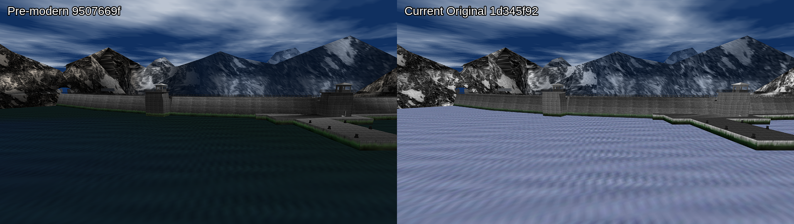
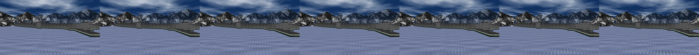
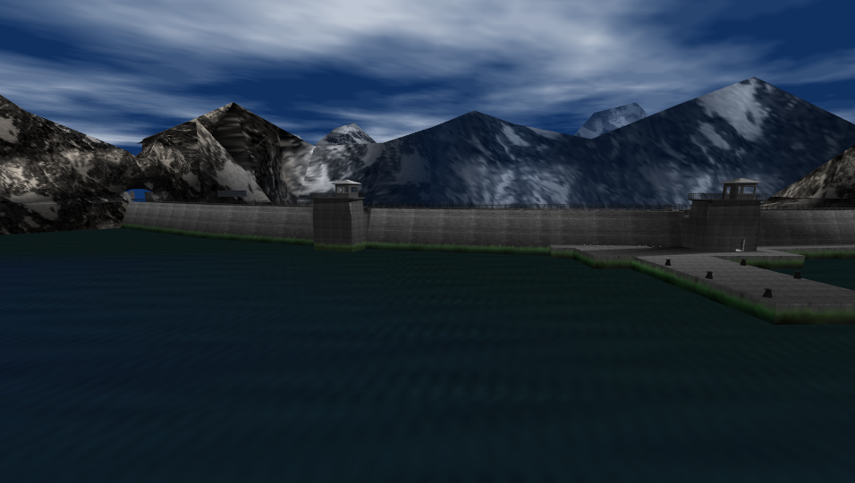

# Original Dam water fidelity review — 2026-09-29

## Scope

This review answers whether the old, pre-modern Dam water texture was modified.
It compares the same camera and room in the current renderer with the immediate
parent of `7324a9ce` (`feat(port): modernize graphics stack and water
rendering`). The comparison uses the PC `Original` graphics preset; it does not
claim to be a console-reference capture.

The deterministic camera is stored in
`tests/dam_original_water_camera.gdb`. It places the view at
`(4280.09, 428.009, -10700.2)`, angles it at `(180.0, 351.47)`, and selects
room 35 after 40 calls to `lvlViewMoveTick`.

## Result

The visible water did change. At the same camera, the pre-modern build at
`9507669f` renders dark teal water, while current `Original` at `1d345f92`
renders bright lavender/checkered water. The current appearance persists over
a complete sampled animation cycle:

The corrected `Original` path preserves the ROM command state and restores the
authored dark-teal modulation while retaining the animated two-texture blend:

This is a presentation change, not a replacement of the authored texture
asset. The transition is associated with the renderer and display-list state
handling introduced by `7324a9ce`.

## Findings

1. Dam's room water uses the two-layer CI8 setup
   `MipMap2C_Something2_Setup` in `src/game/unk_092E50.c`. It combines
   `TEXEL0` and `TEXEL1` using `PRIM_LOD_FRAC`.
2. Before `7324a9ce`, the PC build updated that fraction through
   `((u32 *)setup)[8]`. A PC `Gfx` is 16 bytes, so this N64-word index did not
   address the prim-color command. The fraction therefore remained at its
   initial value instead of animating as authored.
3. `7324a9ce` correctly redirected the write to `setup[4].words.w0` on PC and
   added `ge007_unk_092e50_test` coverage. Reverting that correction restores
   the old-looking output only by restoring a real 64-bit display-list ABI
   bug; it is not an acceptable fidelity fix.
4. The current renderer also derived tile extents with unsigned subtraction.
   An animated tile end below its start underflowed to a huge extent, and an
   authored `0..0` window could be mistaken for a literal one-texel sub-tile.
   A port-owned policy now rejects inverted rectangles and preserves full-image
   wrapping for the unset masked window. This was established with a failing
   link-level regression target before implementation.
5. Disabling `Video.WrapFix` does not restore the pre-modern colour. The
   matched current capture remains lavender, so the wrap defect is real but is
   not the primary colour regression.
6. Frigate/Surface sky-water and the D229 sky-water path are separate from
   this authored Dam room material.
7. A matched live debugger trace identified the colour boundary. At the water
   combiner, `9507669f` had `G_LIGHTING` clear and supplied the authored
   `SHADE=(27,51,40)`. Current `Original` had `G_LIGHTING` set and replaced it
   with computed `SHADE=(255,255,255)`. Texture tiles, TMEM selection, valid
   light records, and the two-cycle combiner were otherwise intact.
8. The extra state came from a port-only room-lighting restore added after the
   sky pass. That restore now applies only to Enhanced and Remaster. Original
   once again inherits the ROM display-list state; the modern tiers retain
   their deliberate relighting path.

## Evidence

- `artifacts/screenshots/original-water-fidelity/pre-modern-fixed-camera.png` —
  build `9507669f`, matched camera.
- `artifacts/screenshots/original-water-fidelity/current-original-fixed-camera.png`
  — build `1d345f92`, `Original`, `Video.WrapFix=1`.
- `artifacts/screenshots/original-water-fidelity/current-original-wrap-off-fixed-camera.png`
  — build `1d345f92`, `Original`, `Video.WrapFix=0`.
- `artifacts/screenshots/original-water-fidelity/current-original-full-cycle.png`
  — current frames 120 through 360 sampled every 40 frames.
- `artifacts/screenshots/original-water-fidelity/fixed-original-rom-water.png`
  — corrected `Original` frame 160, captured from the running game with the
  same deterministic camera and modern PostFX disabled.

The pre-modern build did not support the newer frame-exit/dump-directory
controls, so it was stopped after its deterministic frame capture. No supported
N64 emulator was available in this workspace, and no matched-camera console
capture is claimed.

## Decision

Keep the existing PC ABI correction and tile-wrap safety fix. Do not add a
legacy/static-LOD compatibility switch: the animation and combiner were not
the colour defect. Preserve the ROM room-lighting state in Original, and keep
the port-only room-lighting restore scoped to Enhanced and Remaster. The user
confirmed the dark-teal appearance as the ROM target; no independently
captured emulator frame is claimed.
